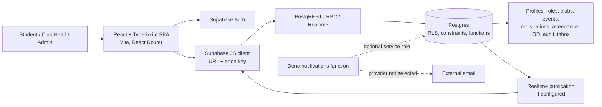
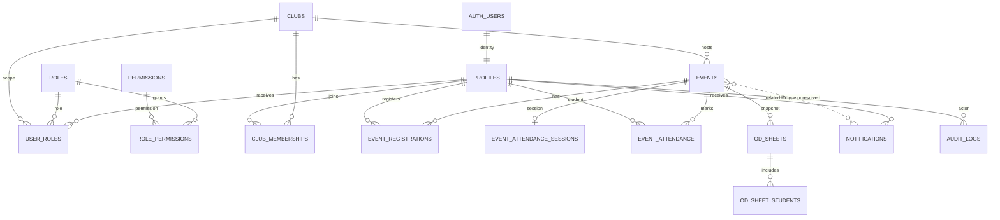

# College Clubs Management System — Technical and Functional Guide

## Evidence conventions and current-state caveat

This document describes checked-in repository evidence as inspected 15 October 2026. “Implemented” means source, migration and/or UI exists; it does not establish runtime success or deployment. No hosted database was inspected and tests were not run. Migrations describe intended schema only. The active `.env.local` was intentionally not opened or reproduced.

There is documentation drift: `README.md` calls events and attendance unimplemented, and `docs/schema.md` marks event-family tables as placeholders. Later M2/M3 migrations and web pages implement event workflows, attendance, OD and reporting. Later code/migrations are treated as implementation evidence; live schema still requires verification.

## 1. Project overview

A browser-based system for college clubs, roles, events and participation. Intended users supported by code are students, club heads and admins. Implemented workflows span account/profile, club administration and directory, scoped event management, event discovery and registration, participant review, attendance, OD sheet generation, notifications, audit and dashboards. Membership lifecycle, recruitment, committees, volunteer coordination and bookings/finance remain placeholders or legacy schema, not complete features.

There is no custom REST server. The React SPA uses Supabase Auth, PostgREST table access, Postgres RPC functions and Realtime. Security-sensitive writes live in guarded SQL functions. A Deno notification Edge Function exists, but external mail delivery is not integrated/verified.

## 2. Architecture

`apps/web/src/lib/supabase.ts` constructs the browser client from Vite variables, with local placeholders as defaults. `AuthContext.tsx` tracks Supabase session/profile; `ProtectedRoute.tsx` establishes signed-in access, while permission UI uses `usePermission`/`Can`. The client issues RLS-protected reads or RPC calls. Postgres performs permission checks and mutations. Notification realtime plus window-focus refetch updates the UI. No object storage or custom server was found.

## 3. Users, identity and authorization

| Role | Purpose | Enforcement/evidence |
|---|---|---|
| `student` | Published event discovery, own registration/cancellation, participation and notification views. | Active-profile and role checks in registration RPCs; grants/catalog in M1/M2 SQL. |
| `club_head` | Manage assigned clubs/events, participant lists, attendance and OD. | Active `user_roles` club scope and `has_permission('events.manage', club_id)`/`assert_event_manager`; global marker alone is insufficient. |
| `admin` | Global user/role, club, audit and dashboard administration. | Admin permission checks in SQL helpers/RPCs; global permissions. |

Supabase Auth UUID is `auth.uid()` and maps to `profiles.id`. Signup passes `full_name`; DB trigger `handle_new_user()` makes the profile and falls back to the email local part. `user_roles` stores role assignments, optional club scope, active/deactivated history. Club-head base role and club assignment are distinct. UI checks improve navigation but are not security boundaries; RLS and guarded RPCs must enforce access. Protected routes require authentication only. SQL checks for active profile in sensitive event functions. Password reset/email behavior depends on Supabase project configuration; no SSO is shown.

## 4. Features and workflows

### Authentication/profile — Implemented

Routes `/login`, `/signup`, `/forgot-password`, `/reset-password`, `/profile`. `AuthContext` exposes `signIn`, `signUp`, `signOut`, reset and password update methods using Supabase Auth. Signup metadata drives profile trigger. Profile page reads/updates own `profiles` row. Profile schema evolves across `20261014000100_m1_identity_clubs_membership.sql`, `20261014000200_m1_profile_fields.sql`, and `20261015001300_m3_roll_number_profile.sql`. UI validation is in `apps/web/src/lib/validation.ts`; Supabase errors are surfaced locally.

### Clubs and roles — Implemented

Admin club create/edit/active state in `ManageClubsPage.tsx` and `ManageClubPage.tsx`; shared wrappers call `create_club`, `update_club`, `set_club_active`, `get_club_heads`. SQL checks permissions, validates fields, enforces case-insensitive naming rules, writes audit, and avoids hard delete. Directory/detail are `ClubDirectoryPage.tsx`, `ClubDetailPage.tsx`, protected by RLS. Role admin at `/roles-permissions` searches profiles and calls `set_user_role`, `assign_club_head`, `revoke_club_head`; writes preserve assignment history and audit/notify. Legacy custom-role RPCs/types remain but are revoked from app users and are not active flow. Membership rows and seed memberships exist; a complete application/join lifecycle does not.

### Events — Implemented

Schema: `20261015000200_m2_event_schema.sql`; functions/policies: M2 migrations including `20261015000400_m2_event_management_rpc.sql`, `20261015000500_m2_student_event_discovery.sql`. `ManageEventsPage.tsx`, `EventFormPage.tsx`, `ManageEventDetailPage.tsx` use manager RPCs for create/list/detail/edit/publish/postpone/cancel. Manager means admin globally or assigned club head for club. SQL validates fields/state transitions, locks rows in relevant mutations, logs audit and emits in-app notifications. Student `EventsPage.tsx` discovers published events with filters; RLS protects unpublished events. `EventDetailPage.tsx` reads event and own registration. Actual event columns include `event_id`, club/creator, title, description, venue/category, start/end/deadline, capacity, status and timestamps. Event status strings are uppercase (`DRAFT`, `PUBLISHED`, `POSTPONED`, `CANCELLED`, `COMPLETED`), unlike old lowercase docs. Checks enforce positive capacity, end after start and deadline <= start; indexes support status/time and club/status/time.

**Identifier inconsistency:** base event table migration uses bigint identity `event_id`, while later M3 function declarations and M1 notification contract use UUID event IDs. Migration names include UUID repair/conversion. The combined final state and generated TS types must be checked before integration; no hosted DB is verified. Do not assume IDs/FK align.

### Registration — Implemented

Student event detail calls registration/cancellation RPCs in `20261015000600_m2_event_registrations_rpc.sql`; `20261015000700_m2_allow_club_head_registration.sql` adjusts role behavior. SQL checks active student, event state/deadline/capacity. Persistent row unique on event/student; cancel changes status and re-registration can reactivate. Event row locking serializes capacity decisions. Notification insertion occurs through trusted helper. `MyRegistrationsPage.tsx` lists registrations; `MyParticipationPage.tsx` calls `list_my_event_participation`. A concurrency SQL test exists (`supabase/tests/10_registration_concurrency.sql`) but was not run.

### Participants/attendance/reports — Implemented

Manager participant listing via `list_event_participants` returns name, department, roll number and registration state only after manager check (`20261015000800_m3_event_participants.sql`). `AttendanceEditor.tsx` reads session/attendance and calls `mark_event_attendance`/`finalize_event_attendance` (`20261015000900_m3_event_attendance.sql`). Status enum: PRESENT/ABSENT/EXCUSED; one record per event/student. Mark requires active registration; session is row-locked; finalized session rejects changes. Finalize requires every current registration marked. Both audit.

`AttendanceReportsPage.tsx` calls `list_attendance_dashboard`, which checks active profile, club permission and pagination (limit 1–500), then aggregates registered/present/absent/excused/unmarked/finalized counts. CSV and browser print are UI exports; there is no server-generated PDF. `MyParticipationPage.tsx` combines own registration and attendance.

### OD sheets — Implemented

`OdSheetsPage.tsx` chooses fields, calls `generate_od_sheet`, then reads snapshots and exports CSV or browser print. `20261015001100_m3_od_sheets.sql` validates title, nonempty allow-listed fields, finalized attendance and manager scope; snapshots event/profile data for PRESENT students only. Tables are manager-read through RLS. This is a local generated record, not institutional leave approval/integration.

### Notifications/audit/dashboard — Implemented with external email incomplete

`NotificationContext.tsx`, `NotificationBell.tsx`, `NotificationsPage.tsx` provide user inbox, unread count and mark-read RPCs. Delivery helpers are trusted-only; event publication targets active students, postponement/cancellation active registrants. Realtime publication is conditionally added by `20261014001000_m1_notifications_realtime.sql`; focus refetch is fallback. Related event ID contract mismatch noted above. `supabase/functions/notifications/index.ts` is a Deno skeleton; no provider adapter is evidenced.

`AuditLogPage.tsx` calls `list_audit_logs` with filters/pagination; direct browser audit reads are revoked. `DashboardPage.tsx` selects admin/club-head/student views; admin stats use `get_admin_dashboard_stats`. `EventsDashboardSlot.tsx` and club `EventsSection.tsx` are extension/visual slots, even though dedicated event pages are implemented. `log_audit` calls occur within business SQL workflows.

### Not implemented as full workflows

`/memberships`, `/recruitment`, `/committees`, `/volunteers`, `/bookings` render placeholders. Original scaffold tables for these domains remain. Do not present them as delivered features. Search/filter controls exist in event discovery and audit; do not infer a system-wide search engine.

## 5. Database design

| Entity | Purpose / keys / notable integrity |
|---|---|
| `profiles` | UUID PK linked to Auth; full name/email, roll number, department, year, contact/avatar/bio/status/active and timestamps evolve through migrations; signup trigger. |
| `roles`, `permissions` | UUID catalogs, unique codes. `role_permissions` composite role/permission link. |
| `user_roles` | UUID assignment/history, user/role/optional club/assigner/status/deactivation fields; FKs and active uniqueness/scope rules in RBAC migrations. |
| `clubs` | UUID, name/slug/description/category/contact/active/status/creator/timestamps; profile FK; memberships and assignments reference it. |
| `club_memberships` | Club/user/status/times; FKs and unique club-user. |
| `notifications` | UUID inbox item, user, type/title/message/read/timestamp, nullable related event ID; user FK. Event link is not verified compatible. |
| `audit_logs` | Bigint append-style record, actor/action/entity/details/time; actor/entity-time indexes; browser table access revoked. |
| `events` | Identity event key, club and creator FKs, metadata/schedule/capacity/status; state/date checks and indexes. |
| `event_registrations` | Identity key, event/student FKs, status and timestamps; unique event/student and status checks; event and student indexes. |
| `event_attendance_sessions` | UUID; unique event, club, OPEN/FINALIZED, finalizer/time; consistency check ties state to finalized timestamp. |
| `event_attendance` | UUID, event/student/status/notes/marker/times; unique event/student; enum and indexes. |
| `od_sheets`, `od_sheet_students` | UUID metadata and JSON snapshots; FKs, title check, sheet/student uniqueness, present-only check; history indexes. |

Full definitions are spread across ordered M1/M2/M3 migrations, including repairs. `packages/shared/src/database.types.ts` is a checked-in/generated type snapshot, not evidence of hosted schema. `supabase/seed.sql` seeds development fixtures and data, not proof of deployment.

RLS is enabled on application tables; privileges are broadly revoked then explicitly granted. Table policies permit user/self, role, club or event-manager reads according to domain. Security-definer functions generally set fixed `search_path`, revoke default execution and grant selected RPCs. Helpers include `has_role`, `has_permission`, `is_club_member`, `can_manage_club`, `assert_event_manager`. `set_updated_at` triggers update timestamps; `handle_new_user` creates profiles. DB constraints/unique keys enforce integrity. Event row locks protect capacity; attendance session locks protect finalization. These are repository-defined, not verified deployed properties.

## 6. Backend/API inventory

No app HTTP route handlers exist. API surface is Supabase Auth, table queries and Postgres RPCs.

| RPC family / function | Purpose and enforcement |
|---|---|
| `has_role`, `has_permission`, `is_club_member`, `can_manage_club` | Shared role/permission/scope decisions for hooks and SQL policies. |
| `set_user_role`, `assign_club_head`, `revoke_club_head` | Admin-only role lifecycle, audit/notification. |
| `create_club`, `update_club`, `set_club_active`, `get_club_heads` | Club writes and scoped heads; validation/audit. |
| `list_audit_logs`, `get_admin_dashboard_stats` | Admin-only filtered/paginated audit and stats. |
| `send_notification[_bulk]`, `get_active_student_ids` | Trusted service/RPC notification fanout. `mark_notification_read`, `mark_all_notifications_read` are user operations. |
| `create_event`, `list_managed_events`, `get_managed_event`, `update_event`, `publish_event`, `postpone_event`, `cancel_event` | Manager-scoped CRUD/state transitions; validation, row locks where needed, audit/notifications. |
| `register_for_event` and cancellation RPC | Active student, capacity/deadline/status, event lock, persistent registration and notifications. |
| `list_event_participants` | Manager-only minimized academic/registration details. |
| `mark_event_attendance`, `finalize_event_attendance` | Manager-only registration checks, upsert, finalization lock/completeness and audit. |
| `list_my_event_participation`, `list_attendance_dashboard` | Own history or scoped aggregate reporting. |
| `generate_od_sheet` | Manager-only finalized attendance snapshot from allow-listed columns. |

Shared wrappers live in `packages/shared/src/helpers.ts`; direct queries are in page/context code. Auth methods in `AuthContext.tsx`: get/current session, password sign-in, signup, logout, reset, password update.

## 7. Technology stack

| Stack | Declared use |
|---|---|
| TypeScript, React 19 | `apps/web` SPA/components. |
| Vite 6, React Router 7 | Build/dev server and client routes. |
| Supabase JS 2 / Supabase Auth | Auth, PostgREST, RPC, Realtime. |
| Supabase Postgres | SQL migrations, RLS, functions, pgTAP tests. |
| Deno | Edge Function source/runtime. |
| Zod | Form/input validation (`src/lib/validation.ts`). |
| Tailwind 3, PostCSS, Autoprefixer | Styling. |
| Vitest 3, Testing Library, jsdom | Unit/component tests. |
| TypeScript 5.9, ESLint 8, Prettier 3 | Typecheck/lint/format. |
| Supabase CLI, Docker | DB reset/test/type scripts and local stack per README. |

Versions are package manifest ranges, not proof of installed runtime versions. Root workspaces are `apps/*` and `packages/*`. No payment, analytics, external storage, mail provider or CI workflow was verified. See `package.json`, `apps/web/package.json`, `packages/shared/package.json` and lockfile.

## 8. Security and reliability

- Browser uses anon key, never a service-role key. `.env.local` was not inspected. README instructs server-side Edge Function secret configuration.
- Authentication is Supabase-managed. RLS and RPC checks are the true boundary; UI gates are not sufficient.
- Sensitive browser writes are generally revoked and routed through functions. Functions use fixed search path and narrow execute grants; verify final state of every function before production.
- SQL validates important event fields/states and registration/attendance constraints; frontend validation is supplemental.
- Unique registration prevents duplicate rows; event locking serializes capacity decisions; attendance unique key and session lock/final state prevent duplicate marks and later edits.
- Audit logs offer DB-level traceability; no external immutable log/SIEM integration was found.
- In-app notification writes can share a SQL transaction with business mutation; external email is absent, so delivery guarantees beyond inbox persistence are unverified.
- Potential integration risk: bigint event identity versus UUID function/contracts, and nullable UUID notification relation. Migration repair files exist but their deployed final outcome is unknown.
- Error handling is mostly Supabase error messages/local page state; exact behavior differs by screen. Seed data is development-only; credentials are omitted here.

## 9. Structure and implementation

- `apps/web/src/pages`: route-level auth, club, event, reports, OD, audit, profile and notification screens.
- `components`: layouts, route guards, permission gate, bell, form field.
- `context`: auth and notifications; `hooks`: permission/role checks; `lib`: client/validation.
- `features`: attendance editor/utilities, club form/slot, RBAC assignment, notification/audit types.
- `packages/shared/src`: database types, typed RPC wrappers/helpers and event utilities.
- `supabase/migrations`: ordered module slices and repairs; read all repairs in sequence.
- `supabase/tests` and `tests/editor`: pgTAP tests and SQL Editor mirrors.
- `supabase/functions/notifications`: Edge Function source.
- `docs/schema.md`: cross-module contract, partly stale versus later schema.
- Root and web config: workspace scripts, TS, lint/format, Vite/Tailwind/Vitest.

## 10. Testing and project status

Web tests cover auth forms, profile, permissions, role assignment, notifications, clubs, event discovery/detail, dashboard and audit; shared helper tests exist. SQL tests cover helpers, RBAC, profile policy, clubs, notifications, events/discovery/registrations and concurrency. Existence does not mean passing. No tests/build/typecheck were executed. Root scripts include `test`, `typecheck`, `lint`, `format:check`, `build`, `db:reset`, `db:test`, `db:types`, `dev`. README says DB tests require Docker/local Supabase. No CI config found in file listing.

Implemented in source: Auth/profile, roles, clubs, notifications, audit, event management/discovery/registration, participants, attendance, OD, dashboards/reports. Partial/unverified: email delivery, deployed Realtime publication and hosted database. Not implemented as user journeys: membership applications, recruitment, committees, volunteers, bookings/finance. No runtime results are claimed.

## 11. Team responsibilities and workflow

Migration comments/prefixes assign M1 to identity/RBAC/clubs/notifications/audit, M2 to events/registration, M3 to participation/attendance/OD/reporting/roll number. This is module ownership, not individual authorship; Git history was not analyzed. `docs/schema.md` specifies cross-module helper contracts.

Main journey: signup creates Auth identity and trigger-created profile; user signs in; admin grants roles and club scope; admin creates club; club head creates draft, validates and publishes event; students discover and register; manager reviews participants and marks/finalizes attendance; OD snapshots present attendees; students view own participation; admin reviews dashboards/audit. At each sensitive step, SQL validates active identity and role/scope. Failures raise SQL exceptions returned to page-local error state. The event capacity lock and attendance finalization lock govern concurrent/terminal decisions.

## 12. Limitations and possible future work

### Current limitations evidenced

- README and schema contract are stale and disagree with implemented M2/M3 pages/migrations and uppercase event states.
- Event ID type/notification FK contract needs definitive reconciliation and type generation against a known schema.
- Hosted migration application and test results are unknown.
- Email provider is absent; notifications are in-app.
- Membership/recruitment/committee/volunteer/bookings routes remain placeholders despite legacy schema.
- No CI was found; no external storage integration; print-to-PDF is browser-side only.

### Future possibilities (not existing features)

Reconcile event IDs and notification FK; regenerate shared types; update docs; add CI; choose and implement mail provider with retry/observability; decide whether to implement or remove legacy placeholders; document production deployment, backups and monitoring.

## Repository evidence index

| Module | Evidence |
|---|---|
| Overview/setup | `README.md`, `docs/schema.md`, `.env.example` |
| Auth/profile | `apps/web/src/context/AuthContext.tsx`, `pages/LoginPage.tsx`, `SignupPage.tsx`, `ProfilePage.tsx`; M1 identity/profile and `20261015001300_m3_roll_number_profile.sql`; `supabase/config.toml` |
| RBAC | `hooks/usePermission.ts`, `components/Can.tsx`, `pages/RoleManagementPage.tsx`, `features/rbac/RoleAssignmentForm.tsx`; M1 RBAC migrations `20261014000300`/`00400` |
| Clubs | `pages/ManageClubsPage.tsx`, `ManageClubPage.tsx`, `ClubDirectoryPage.tsx`, `ClubDetailPage.tsx`, `features/clubs/ClubForm.tsx`; `20261014000700_m1_clubs_rpc.sql`, `20261014000800_m1_clubs_directory_heads.sql` |
| Events/registration | `pages/EventsPage.tsx`, `EventDetailPage.tsx`, `ManageEventsPage.tsx`, `EventFormPage.tsx`, `ManageEventDetailPage.tsx`; M2 migrations `20261015000200`–`00700` |
| Participant/attendance/history | `features/events/AttendanceEditor.tsx`, `pages/AttendanceReportsPage.tsx`, `MyParticipationPage.tsx`; M3 migrations `20261015000800`–`01000`, `01200` |
| OD | `pages/OdSheetsPage.tsx`, `20261015001100_m3_od_sheets.sql` |
| Notifications/audit | notification context/components/pages, `AuditLogPage.tsx`, `DashboardPage.tsx`; M1 notifications/audit migrations `20261014000600`, `00900`–`01300`, `20261015000100` |
| Shared/config/tests | `packages/shared/src/database.types.ts`, `helpers.ts`, `events.ts`; package manifests; `supabase/tests/`, `supabase/tests/editor/`, `apps/web/src/**/*.test.tsx` |

## Unresolved questions and unverified claims

1. Which exact migration sequence is applied to each hosted project? What is live `events.event_id` type?
2. Should `notifications.related_event_id` be bigint/FK or UUID, and are event RPC signatures consistent after all repairs?
3. Are shared database types current with latest M2/M3 migrations?
4. Is `supabase_realtime` present and publishing notifications in each deployment?
5. Is any email provider intended/configured?
6. Are tests/build/typecheck passing? No execution evidence was gathered.
7. What production auth policy, deployment host, backups, monitoring and recovery targets are intended?
8. Are profile update columns appropriately restricted in final combined policy/trigger state?
9. Should legacy schema/routes remain or be removed after coordination?
10. Individual contributors cannot be determined from inspected documentation; Git history was not reviewed.
