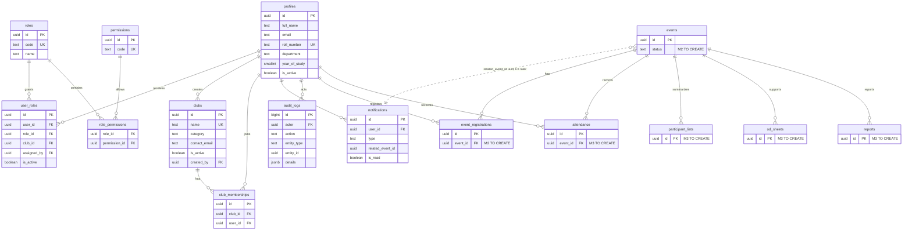

# Shared schema contract

This document describes the Member 1 database contract that Member 2 and Member 3 can consume. Member 1 owns identity, authorization, clubs, Club Head assignments, notifications, and audit logs. Member 2 and Member 3 own their tables and migrations.

## Full project ER diagram



The `events`, `event_registrations`, `attendance`, `participant_lists`, `od_sheets`, and `reports` entities in the diagram are documentation placeholders only. Their tables, enums, RLS, and migrations are to be created by their owners.

## Ownership and access

| Table                                                     | Owner who creates/changes schema | Normal readers                                                                                           |
| --------------------------------------------------------- | -------------------------------- | -------------------------------------------------------------------------------------------------------- |
| `profiles`                                                | M1                               | The profile owner; admins only where the users-management permission is required                         |
| `roles`, `permissions`, `role_permissions`, `user_roles`  | M1                               | Authenticated users only for permission checks; assignments are limited to the user or authorized admins |
| `clubs`                                                   | M1                               | Authenticated users for active clubs; admins and assigned Club Heads may read inactive clubs             |
| `club_memberships`                                        | M1                               | The member and authorized club workflows                                                                 |
| `notifications`                                           | M1                               | Only the notification owner; writes use `send_notification`, and owners may update only `is_read`        |
| `audit_logs`                                              | M1                               | The actor or users with audit-read permission; inserts use `log_audit` only                              |
| `events`, `event_registrations`                           | M2                               | M2 defines access and shares approved reads with M1/M3                                                   |
| `attendance`, `participant_lists`, `od_sheets`, `reports` | M3                               | M3 defines access and shares approved reads with M1/M2                                                   |

Only the table owner changes that table's schema. Teammates should request changes to Member 1 tables rather than editing an M1 migration. A migration owned by this module uses `<timestamp>_m1_<name>.sql`; teammates use the same timestamp format with `m2_` or `m3_`.

## Agreed status strings

These are the shared application strings. M2 and M3 must define them as enums in their own migrations:

- Event status: `draft`, `published`, `postponed`, `cancelled`, `completed`.
- Registration status: `registered`, `cancelled`.
- Attendance status: `present`, `absent`.

M2 should treat valid event transitions as: `draft -> published`; `published -> postponed` or `cancelled`; `postponed -> published` or `cancelled`; and `published` or `postponed -> completed` when the event is over. `cancelled` and `completed` are terminal states.

## Shared SQL interfaces

All examples assume the caller is authenticated and use UUID values only as examples.

```sql
select public.has_role('admin');
select public.has_role('club_head', p_club_id);
select public.has_permission('clubs.manage', p_club_id);
select public.is_club_member(p_club_id);
select public.can_manage_club(p_club_id);
select public.log_audit('event.published', 'events', p_event_id, '{"source":"m2"}'::jsonb);
select public.send_notification(
  p_user_id,
  'event_published',
  'Event published',
  'A club event is now available.',
  p_event_id
);
select public.send_notification_bulk(
  public.get_active_student_ids(),
  'event_published',
  'Event published',
  'A club event is now available.',
  p_event_id
);
```

Signatures:

- `has_role(p_role text, p_club_id uuid default null) returns boolean`: checks an active global role or exact Club Head club scope.
- `has_permission(p_permission text, p_club_id uuid default null) returns boolean`: checks an active permission at the requested scope; admins pass globally.
- `is_club_member(p_club_id uuid) returns boolean`: checks active membership for the current user.
- `can_manage_club(p_club_id uuid) returns boolean`: returns true for an admin or a Club Head assigned to that club.
- `get_club_heads(p_club_id uuid) returns table(id uuid, full_name text)`: returns only active Club Head ids and names for a club; it never exposes other profile columns.
- `create_club(p_name text, p_description text, p_category text, p_contact_email text) returns uuid`: admin-only club creation boundary.
- `update_club(p_club_id uuid, p_name text, p_description text, p_category text, p_contact_email text) returns uuid`: admin-only club update boundary.
- `set_club_active(p_club_id uuid, p_is_active boolean) returns boolean`: admin-only activation boundary; deletion is not supported.
- `log_audit(p_action text, p_entity_type text, p_entity_id uuid, p_metadata jsonb) returns bigint`: appends an audit record as the current actor.
- `send_notification(p_user_id uuid, p_type text, p_title text, p_message text, p_related_event_id uuid default null) returns uuid`: validates the five event types, requires a non-empty title and message, and appends an in-app notification.
- `send_notification_bulk(p_user_ids uuid[], p_type text, p_title text, p_message text, p_related_event_id uuid default null) returns integer`: inserts one notification for each distinct non-null user id and returns the inserted count; it never queries registrations.
- `get_active_student_ids() returns setof uuid`: returns active users with the global `student` role for event-publication fan-out.
- `mark_notification_read(p_id uuid) returns boolean`: marks only the current user's notification and returns whether an unread row changed.
- `mark_all_notifications_read() returns integer`: marks only the current user's unread notifications and returns the number changed.

After a teammate's RPC completes its business write successfully, call the helpers in the same transaction before returning:

```sql
perform public.log_audit(
  'event.published',
  'events',
  v_event_id,
  jsonb_build_object('club_id', v_club_id)
);

perform public.send_notification(
  v_user_id,
  'event_published',
  'Event published',
  v_event_title,
  v_event_id
);
```

Do not insert directly into `audit_logs` or `notifications` from a client. The notification helpers accept these event types only: `event_published`, `registration_confirmed`, `registration_cancelled`, `event_postponed`, and `event_cancelled`. The delivery helpers revoke `anon` and `authenticated` execute access; a teammate's `SECURITY DEFINER` RPC calls them after its own successful write, while the function runs as its trusted owner. Email delivery remains an Edge Function concern.

Example registration RPC pattern:

```sql
-- inside a SECURITY DEFINER registration RPC, after the insert succeeds
perform public.send_notification(
  auth.uid(),
  'registration_confirmed',
  'Registration confirmed',
  'Your registration was confirmed.',
  p_event_id
);
```

The existing RBAC assignment RPCs also retain their internal notification types (`club_head.assigned`, `club_head.revoked`, and `user_role.changed`) for backwards-compatible in-app notices. New event workflows must use the five event types above.

## Club details event placeholder

The Member 1 web contract includes `<EventsSection clubId={clubId} />` on the club detail page. It is currently a visual placeholder and performs no events-table query. Member 2 may replace its implementation once the events schema exists, keeping `clubId: string` as the input contract.

## Notification delivery and Realtime

The delivery helpers are intentionally not callable by `anon` or `authenticated`. A teammate's `SECURITY DEFINER` RPC performs its own successful write first, then calls `send_notification` or `send_notification_bulk`; the nested call executes under the trusted RPC owner. Server-side `service_role` code may also call them. Browser code uses only `mark_notification_read` and `mark_all_notifications_read`.

The web app uses a plain RLS-protected count query (`select id ... count: exact, head: true`) for unread count; no separate unread-count function is needed. The Realtime migration adds `notifications` to `supabase_realtime` when available. Realtime is recommended for immediate bell updates, while the app also refetches on window focus as a fallback.

## Notifications to wire up

| Trigger                | Type                     | Recipients                                                              | Caller                           |
| ---------------------- | ------------------------ | ----------------------------------------------------------------------- | -------------------------------- |
| Event published        | `event_published`        | All active students, using `get_active_student_ids()` and bulk delivery | M2 event-publish RPC             |
| Registration succeeds  | `registration_confirmed` | The registering student                                                 | M2 registration RPC              |
| Registration cancelled | `registration_cancelled` | The affected student                                                    | M2 registration-cancellation RPC |
| Event postponed        | `event_postponed`        | Registered students for that event                                      | M2 event-postpone RPC            |
| Event cancelled        | `event_cancelled`        | Registered students for that event                                      | M2 event-cancel RPC              |

`notifications.related_event_id` is intentionally a plain nullable UUID today. After M2's `events` table is merged and its final primary key is agreed, Member 1 will add the foreign key in a later M1 migration. No event table or event foreign key is created here.

## Pending: notifications FK

Step 0 found no `public.events` table in `supabase/migrations`. After M2's events table exists and its `id` column is confirmed as `uuid`, apply this statement in a new M1 migration:

```sql
alter table public.notifications
  add constraint notifications_related_event_id_fkey
  foreign key (related_event_id)
  references public.events(id)
  on delete set null;
```
